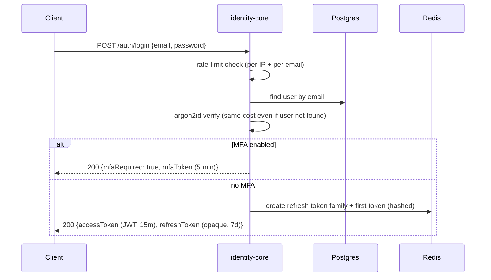
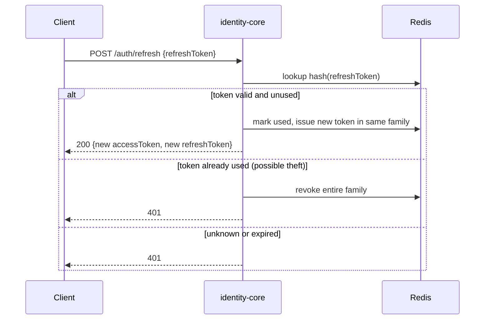

# Authentication flows

## Login (password)

## Refresh with rotation and reuse detection

## MFA (TOTP)

1. Login returns `mfaRequired` plus a short-lived `mfaToken` (not an access token).
2. `POST /auth/mfa/verify {mfaToken, code}` checks the TOTP code, then issues the real token pair.
3. Failed codes count toward the same rate limit as passwords.

## Security rules (apply everywhere)

- Login errors are identical for "unknown email" and "wrong password".
- Unknown emails still run a dummy argon2 verification so response time doesn't leak which emails exist.
- Logout revokes the refresh token family.
- Password change or reset revokes all of the user's families.
