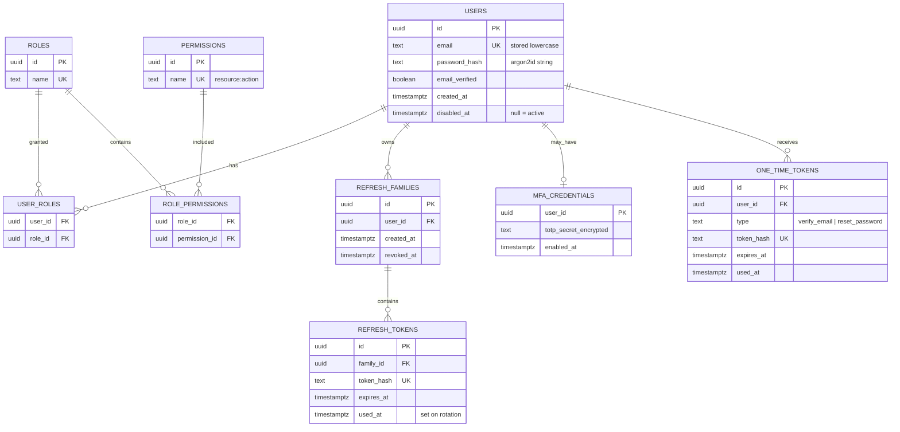

# Data model

## Decisions

- Refresh tokens and one-time tokens are stored as **hashes**, never raw.
- TOTP secrets must be stored **encrypted** (not hashed), because we need
  the original to verify codes. The encryption key comes from config.
- Soft-disable users (`disabled_at`) instead of deleting, to keep audit history.
- Redis is a fast path for refresh lookups, and Postgres is the source of truth.
  Whether to keep refresh tokens in both is a trade-off we settle in Step 5.
